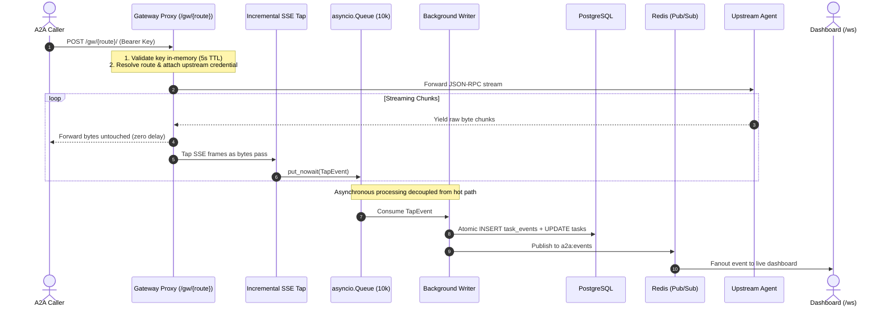

# Architecture

A2A Gateway is a self-hosted control plane and reverse proxy built specifically for Agent-to-Agent (A2A) protocol JSON-RPC workflows. It routes traffic through a single observable endpoint, parses streaming lifecycles without buffering, and provides full forensic history.

---

## Architecture Diagram



---

## Core Architectural Concepts

### 1. Two Independent Planes in One Process
- **Data Plane (Hot, Lean):** Serves `POST /gw/{route}/` and `GET /gw/{route}/.well-known/agent-card.json`. It never runs heavy SQL queries. Key validation and route lookups hit a fast 5-second in-memory cache. Byte forwarding executes immediately via `httpx.AsyncClient.stream` and `StreamingResponse(media_type="text/event-stream")`.
- **Control Plane (Cold, Rich):** Serves `/control/*` REST endpoints, static dashboard assets, and the `/ws` WebSocket fanout. It handles agent registration, route bindings, API key rotation, and triage timeline queries.

### 2. The Proxy Interface as a Swap Point
All forwarding logic is isolated behind `ProxyBackend` in `app/proxy/interface.py`:
```python
class ProxyBackend(Protocol):
    async def forward(
        self,
        route: ResolvedRoute,
        request_headers: dict[str, str],
        body: bytes,
        on_event: Callable[[TapEvent], None],
    ) -> ProxyResult: ...
```
In v0.1, `HttpxProxyBackend` implements this protocol using Python asyncio. If throughput demands an Envoy, Rust, or C++ data plane in the future, the backend can be swapped out without altering the control plane, database schema, or dashboard interface.

### 3. Event-Sourced Persistence and Projection
State is derived from events, not overwritten arbitrarily:
- `task_events` is append-only and acts as the source of truth. Every status-update, artifact chunk, and forensic note is recorded with a monotonic `seq` number and observed timestamp.
- `tasks` is a denormalized projection tracking current state, started timestamp, last active timestamp, and terminal flags, maintained atomically by the writer.
- Reconstructed timelines on `GET /control/tasks/{id}/timeline` rebuild purely from the ordered sequence in `task_events`.

### 4. Acknowledgment Semantics
The gateway operates under **persist-before-acknowledged** internal semantics:
- The tap observes bytes as they traverse the hot path and immediately delegates them to `asyncio.Queue` via non-blocking `put_nowait()`.
- If the queue exceeds `EVENT_QUEUE_MAXSIZE`, the gateway increments a `dropped_events` counter rather than blocking caller stream transmission.
- *Explicit caveat:* Persisted does not equal delivered to caller; delivered does not equal persisted. The tap observes bytes on the wire as they pass, ensuring protocol pass-through integrity without introducing buffering overhead.

### 5. What Happens When the Gateway Restarts?
Consider an in-flight research task streaming multiple steps when the gateway process abruptly restarts:
1. Prior to restart, every event that passed through the gateway was persisted to `task_events` with an incremental sequence number.
2. The caller's connection drops cleanly per standard TCP stream termination. Upstream network errors trigger synthetic `gateway.note` events recording the exact connection reset context.
3. Upon gateway restart, the database contains all prior events intact.
4. Calling `/control/tasks/{id}/timeline` immediately reconstructs the exact state of the task up to the interruption, including the forensic evidence of where and why the connection died.
5. In-flight history survives restarts by design without requiring distributed transaction locks.
